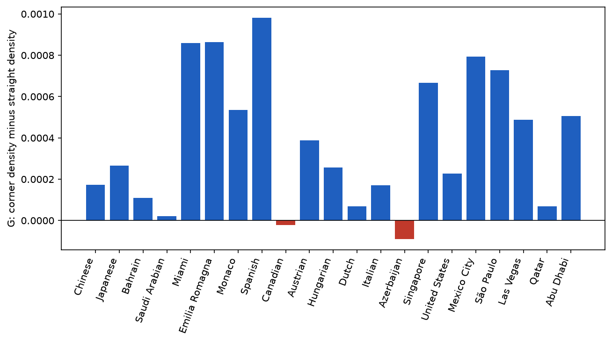
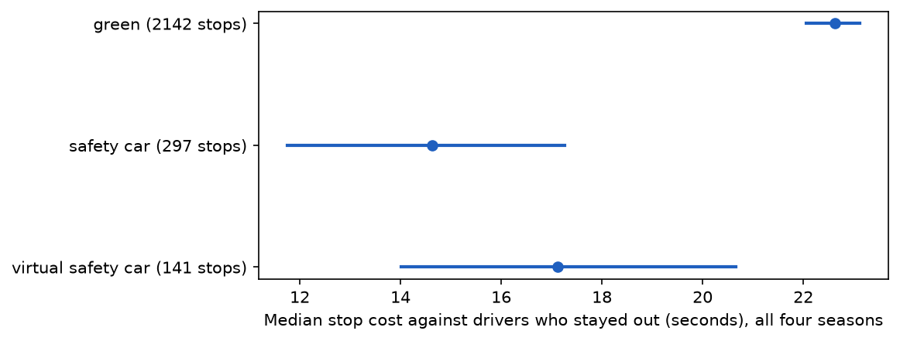
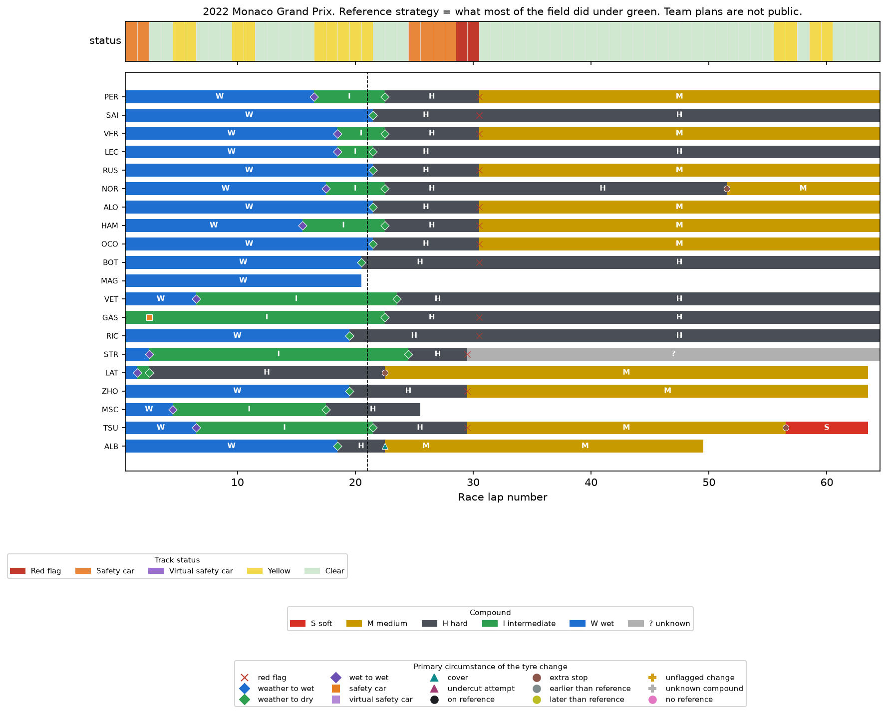
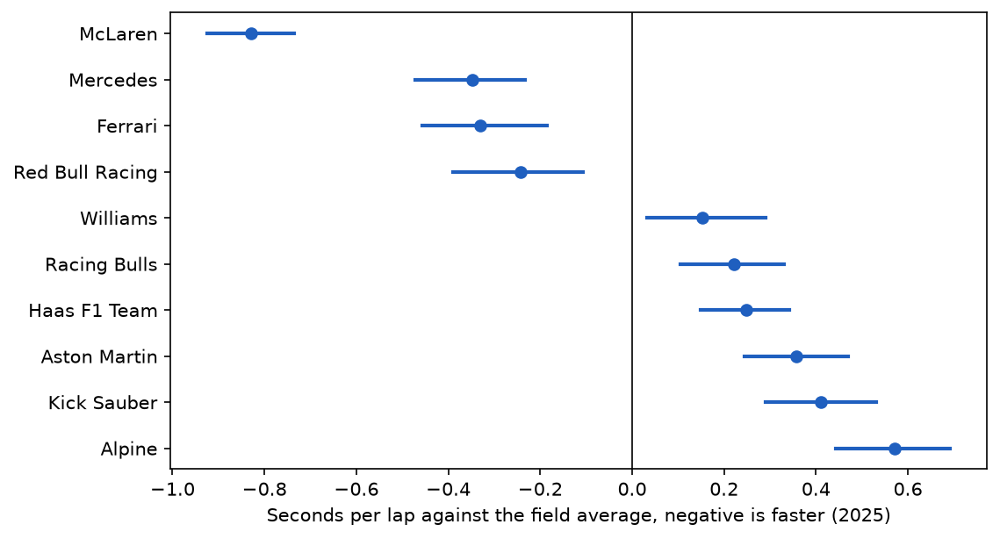

# More results

These are the other studies in this project, moved here from the README so that the front page stays short.

## Where degradation costs time, all dry 2025 races (planned in advance)

T1 = 0.000384 (indicative interval 0.000250 to 0.000525) over 21 races. G was above zero in 19 races. G is the fitted degradation per second of lap time in corner mini-sectors minus the same on straight mini-sectors, for the compound with the most kept laps in each race.

## Pit strategy (exploratory)

What a team planned before a race is not public, so this analysis never claims to know a plan. It defines a reference strategy from what most of the field did under green and tags each tyre change with the circumstances the data shows. These results are exploratory and were not pre-registered. For all four seasons together, a safety car or a virtual safety car is the primary circumstance of 16.7 percent of tyre changes. The median stop cost is 22.632 s under green and 14.630 s under a safety car, and green minus safety car is 8.001 s (indicative interval 5.290 to 10.869). Undercut attempts: 117 succeeded, 86 failed, 344 not resolved, a success share of 57.6 percent of 203 resolved. 77.8 percent of completing drivers differed from the reference. A stint number change with pit flags set where the same tyre continued is not counted as a tyre change (see `EXPLORATORY_ANALYSIS_PLAN_AMENDMENT_1.md`).

## Corrected race pace (exploratory)

Pace is the driver coefficient of model M1, centred on the drivers of the race. Car and driver are not separated, and traffic, damage, team orders and pace management are in the numbers. Wet races are left out. These results are exploratory. The top three teams of 2025, in seconds per lap against the field average (negative is faster):

1. McLaren: -0.830 s per lap (indicative interval -0.924 to -0.736, 21 races).
2. Mercedes: -0.348 s per lap (indicative interval -0.472 to -0.232, 21 races).
3. Ferrari: -0.331 s per lap (indicative interval -0.457 to -0.186, 21 races).

## Telemetry case study

The race is the Bahrain Grand Prix. I cut each clean lap into 25 mini-sectors and fitted the linear model to each one. 945 of 951 clean laps passed the lap time match check. For SOFT, corner mini-sectors carry 72.8 percent of the fitted degradation and straight mini-sectors carry 27.2 percent. For MEDIUM, corner mini-sectors carry 77.3 percent of the fitted degradation and straight mini-sectors carry 22.7 percent. For HARD, corner mini-sectors carry 75.8 percent of the fitted degradation and straight mini-sectors carry 24.2 percent. Each lap's mini-sector times are scaled to add up to the official lap time, and every mini-sector uses the same model, so the mini-sector rates must add up to the lap-time rate. They do, to within 1e-6. That checks the bookkeeping, not the physics. This is one race and says nothing about other circuits.
