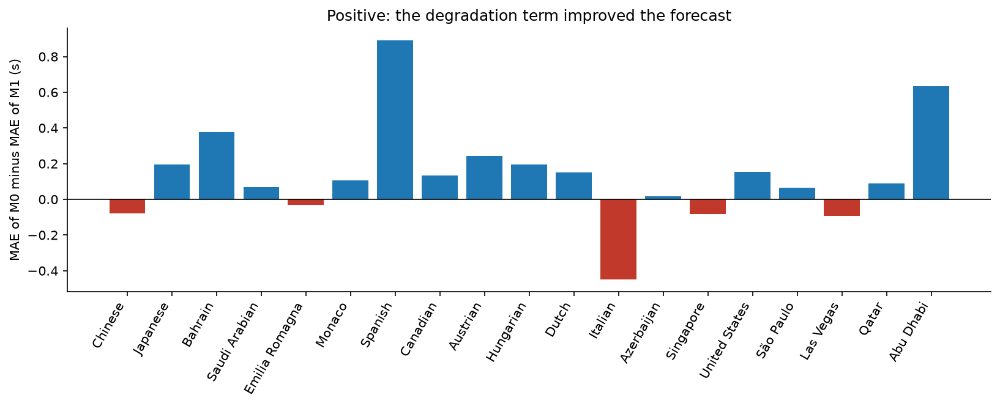
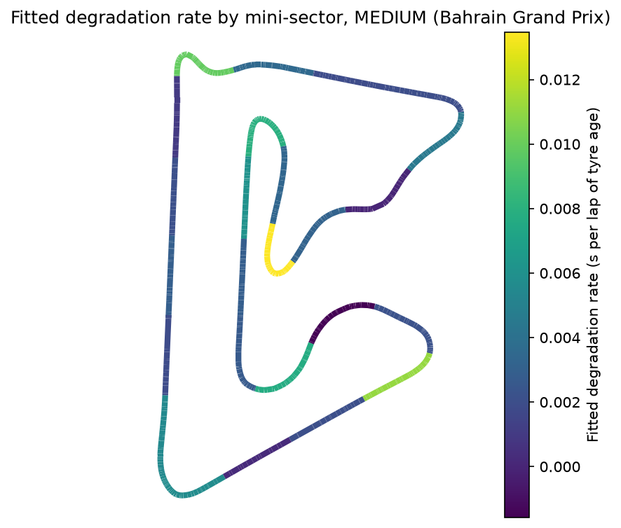
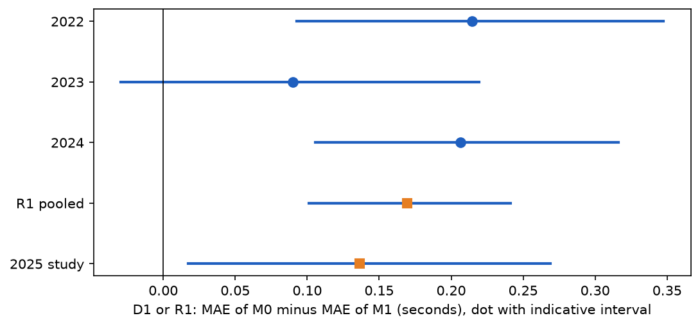
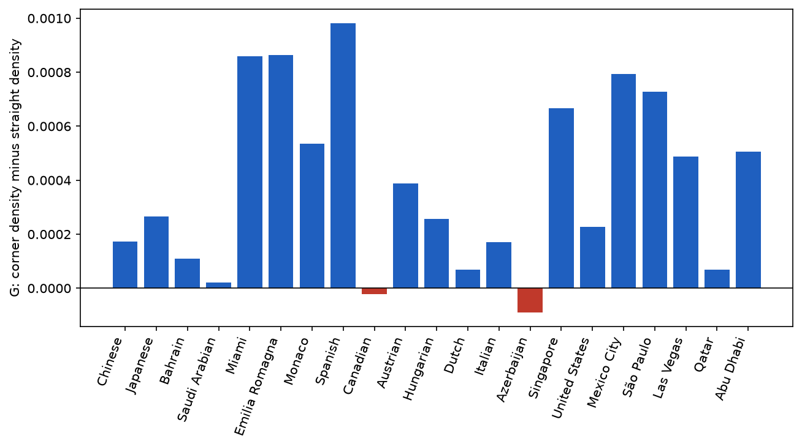
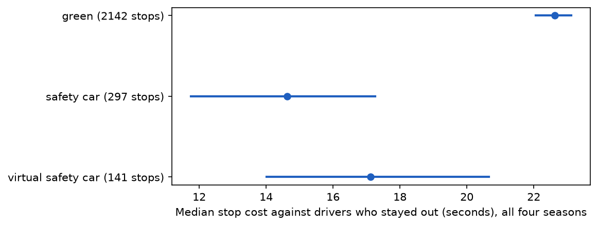
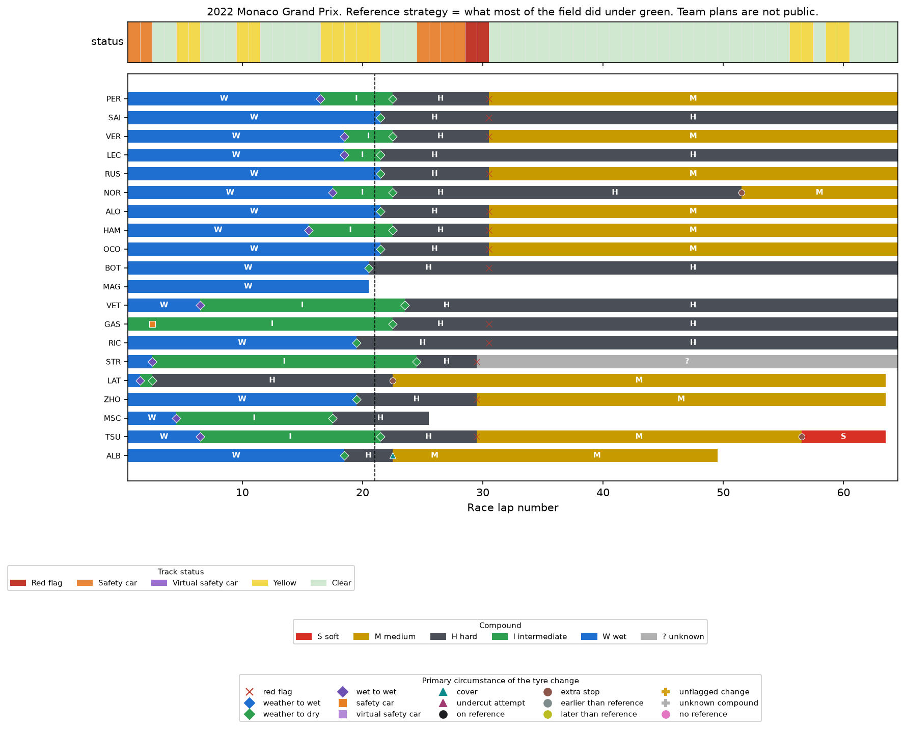
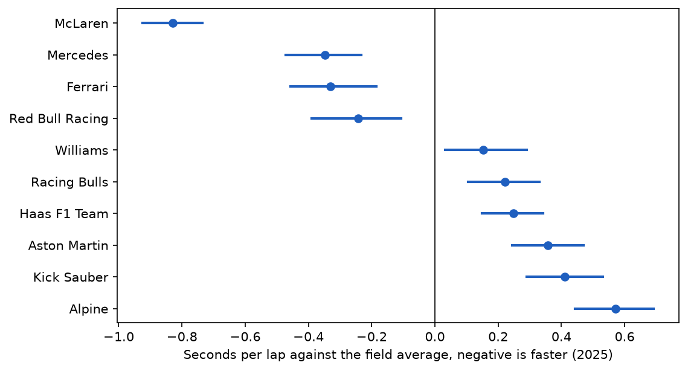

# F1 tyre degradation study, 2025 season

I tested whether a lap-time model with a tyre degradation term forecasts the rest of a race better than a model without one, using only laps run before 60 percent race distance. The forecast is not blind: for each later lap it is given the compound and the tyre age that the driver actually ran. So it tests whether a degradation term predicts lap times when the real stints are known, and it does not predict pit stops or tyre choices. I also fitted the degradation rate by mini-sector in one race (Bahrain) using car telemetry.

## Headline result

- Validation-eligible races: 19 of 24 (3 wet, 0 failed loads). The other 2 dry races fail the eligibility rules, as `results/races.csv` records: the Miami Grand Prix has 187 fitting laps (the minimum is 200) and the Mexico City Grand Prix has a design matrix for M0 that is not full rank.
- D1 = 0.136 s (indicative interval 0.017 to 0.269). D1 is the mean over races of MAE of the model without degradation minus MAE of the linear degradation model. Positive means the degradation term helped.
- The linear degradation model beat the model without it in 14 of 19 races.
- Pooled test MAE: 0.780 s without degradation, 0.640 s with linear degradation.

In these races the degradation term improved the forecast on average, and the indicative interval for D1 is above zero.

The quadratic model was worse than the linear one: D2 = -0.072 s (indicative interval -0.134 to -0.021), and the quadratic model beat the linear one in 4 of 19 races.





## Replication on 2022 to 2024 (planned in advance)

R1 = 0.169 s (indicative interval 0.101 to 0.241) over 59 races pooled. The linear degradation model beat the model without it in 45 of 59 races. Per season, 2022: D1 = 0.215 (0.093 to 0.348), 2023: D1 = 0.090 (-0.030 to 0.219), 2024: D1 = 0.206 (0.106 to 0.316).

The replication interval for R1 is above zero: the 2025 result held in 2022 to 2024. That holds for the three seasons taken together. On its own, the 2023 interval includes zero.



## Where degradation costs time, all dry 2025 races (planned in advance)

T1 = 0.000384 (indicative interval 0.000250 to 0.000525) over 21 races. G was above zero in 19 races. G is the fitted degradation per second of lap time in corner mini-sectors minus the same on straight mini-sectors, for the compound with the most kept laps in each race.



## Pit strategy (exploratory)

What a team planned before a race is not public, so this analysis never claims to know a plan. It defines a reference strategy from what most of the field did under green and tags each tyre change with the circumstances the data shows. These results are exploratory and were not pre-registered. For all four seasons together, a safety car or a virtual safety car is the primary circumstance of 16.7 percent of tyre changes. The median stop cost is 22.632 s under green and 14.630 s under a safety car, and green minus safety car is 8.001 s (indicative interval 5.290 to 10.869). Undercut attempts: 117 succeeded, 86 failed, 344 not resolved, a success share of 57.6 percent of 203 resolved. 77.8 percent of completing drivers differed from the reference. A stint number change with pit flags set where the same tyre continued is not counted as a tyre change (see `EXPLORATORY_ANALYSIS_PLAN_AMENDMENT_1.md`).





## Corrected race pace (exploratory)

Pace is the driver coefficient of model M1, centred on the drivers of the race. Car and driver are not separated, and traffic, damage, team orders and pace management are in the numbers. Wet races are left out. These results are exploratory. The top three teams of 2025, in seconds per lap against the field average (negative is faster):

1. McLaren: -0.830 s per lap (indicative interval -0.924 to -0.736, 21 races).
2. Mercedes: -0.348 s per lap (indicative interval -0.472 to -0.232, 21 races).
3. Ferrari: -0.331 s per lap (indicative interval -0.457 to -0.186, 21 races).



## Why this is hard

Inside one stint, tyre age and race lap number both go up by one every lap. Tyre wear makes the car slower. Fuel burn and track rubbering make it faster. From one stint these cannot be separated. Across a race they can, because drivers pit on different laps, so at the same race lap different cars have tyres of different ages. Every model uses driver and compound effects and a race lap number term. No fuel effect is assumed. It is estimated as the lap number coefficient.

## Results table

Pooled over the validation-eligible races, test laps only (seconds).

| Model | MAE | RMSE | Bias |
|---|---|---|---|
| M0 | 0.780 | 1.054 | 0.246 |
| M1 | 0.640 | 0.904 | -0.050 |
| M2 | 0.709 | 1.002 | -0.098 |

M0 has no degradation term, M1 has a linear term per compound, M2 adds a quadratic term. Bias is predicted minus actual.

## Method

- Season 2025, Grand Prix sessions only. Data from FastF1.
- A race is wet if any lap used INTERMEDIATE or WET tyres. Wet races are excluded.
- Clean lap: lap time present, lap 2 or later, not a pit-in or pit-out lap, track status exactly "1", IsAccurate true, dry compound with tyre age known, and no slower than 107 percent of the fastest such lap.
- Three OLS models per race, with driver and compound effects and race lap number. M1 adds tyre age per compound, M2 adds tyre age squared per compound.
- The forecast is made at 60 percent of race laps. Fitting uses laps up to the cutoff. Testing uses later laps. The slow-lap threshold uses fitting laps only.
- Each test lap is predicted from that lap's real `Driver`, `Compound`, `LapNumber` and `TyreLife` columns. M0 uses the first three and M1 and M2 also use `TyreLife`. The model is never asked which tyre a driver will choose or when they will pit. Test laps on a compound with no kept fitting laps, or for a driver with no fitting laps, are dropped. That removes 109 test laps pooled over the 19 races, which is 1.4 percent of the 7641 test laps before the drop (`test_laps_removed` and `test_laps` in `results/races.csv`).
- The test laps are only the later laps that pass the clean-lap rules, so every forecast error here is for normal-pace laps. All seven rules are applied to the later laps too. The 107 percent threshold is set from fitting laps only and then applied to every lap.
- The real tyre age on each later lap also tells M1 and M2 when each driver pitted. M0 has no term for laps since the last stop. So D1 measures what tyre age adds when the stints are known, and it does not separate tyre wear from the jump in pace after a pit stop.
- Eligibility: at least 200 fitting laps, 100 test laps, full column rank for all three designs, compounds with at least 30 fitting laps.
- Primary metric D1 with a race-level bootstrap (10000 resamples, seed 42).

## Telemetry case study

The race is the Bahrain Grand Prix. I cut each clean lap into 25 mini-sectors and fitted the linear model to each one. 945 of 951 clean laps passed the lap time match check. For SOFT, corner mini-sectors carry 72.8 percent of the fitted degradation and straight mini-sectors carry 27.2 percent. For MEDIUM, corner mini-sectors carry 77.3 percent of the fitted degradation and straight mini-sectors carry 22.7 percent. For HARD, corner mini-sectors carry 75.8 percent of the fitted degradation and straight mini-sectors carry 24.2 percent. Each lap's mini-sector times are scaled to add up to the official lap time, and every mini-sector uses the same model, so the mini-sector rates must add up to the lap-time rate. They do, to within 1e-6. That checks the bookkeeping, not the physics. This is one race and says nothing about other circuits.

## Pre-registration

`PREREGISTRATION.md` was written before any data was downloaded. It fixes the question, the models, the split, the eligibility rules, the metrics and every constant. It was not changed afterward. The commit history here does not show this order, because I uploaded the finished project in a few commits.

## Tests

`pytest` runs 50 tests: 15 in `tests/test_f1deg.py` (lap filters, slow-lap rule, wet flag, gap ahead, split and cutoff, absence of leakage, recovery of known rates, null case, unseen drivers and compounds, the fuel and tyre confound, mini-sectors, bootstrap, error metrics), 1 in `tests/test_replication.py` (the season function reproduces every 2025 result table), 20 in `tests/test_strategy.py`, 7 in `tests/test_pace.py`, 5 in `tests/test_telemetry_season.py` and 2 in `tests/test_offline.py` (only the download scripts import FastF1).

## Limitations

- Lap times show the pace drivers chose, so the fitted rate includes tyre management and is not the physical limit of the tyre.
- The lap number term is linear and absorbs fuel burn, track evolution and anything else that moves steadily through a race. These are not separated from each other.
- Fuel loads, engine modes, tyre temperatures and pressures are not public.
- Dirty air is only handled by the clean-air sensitivity check.
- Safety car periods cool the tyres and reset nothing in the model.
- Damage and lift-and-coast are not identified.
- One season and about 20 dry races is a small sample.
- Compounds are different physical tyres at different races.
- Mini-sector boundaries come from integrated speed, so they shift slightly from lap to lap.
- The timing data is unofficial.
- Since October 2026 FastF1 needs an F1TV account to download timing data. The committed CSVs let the study and notebooks reproduce without one, but `run_telemetry.py` and `python download_data.py --refresh` need a signed-in account.
- The replication seasons share the model and filters of 2025, so a flaw shared by all of them would replicate too.
- Strategy tags are rules applied to lap data and do not know team intent.
- Pace numbers do not separate car from driver.
- Telemetry results are for one season.

## Data source and disclaimer

Data comes from the FastF1 library, which reads Formula 1 live timing. This project is unofficial and is not associated with Formula 1, the FIA, or any team. Lap and telemetry data were downloaded once with FastF1 from an F1TV account. Downloading again needs an account. Everything after the download runs from the saved files with no account and no network, and `python offline_check.py` proves it.

## File layout

- `config.py`, `expansion_config.py`: constants of the 2025 study and of the expansion.
- `PREREGISTRATION.md`, `PREREGISTRATION_REPLICATION.md`, `PREREGISTRATION_TELEMETRY_SEASON.md`: designs fixed before the data.
- `EXPLORATORY_ANALYSIS_PLAN.md`: plan of the exploratory modules.
- `EXPLORATORY_ANALYSIS_PLAN_AMENDMENT_1.md`: one amendment to the strategy rules, with counts and before and after values.
- `download_data.py`, `download_seasons.py`: lap downloads with FastF1.
- `write_download_complete.py`: writes `data/DOWNLOAD_COMPLETE.json`.
- `f1deg.py`: library for the 2025 study.
- `run_study.py`: season study, writes `results/`.
- `run_telemetry.py`: Bahrain telemetry case study.
- `replication.py`, `run_replication.py`: the season study as a function and its run on 2022 to 2024.
- `strategy.py`, `run_strategy.py`: pit strategy module.
- `pace.py`, `run_pace.py`: corrected pace module.
- `telemetry_season.py`, `run_telemetry_season.py`: mini-sector telemetry for every dry 2025 race.
- `run_links.py`: rank correlations across modules.
- `check_consistency.py`: checks README numbers against `results/`.
- `offline_check.py`: reruns the offline scripts with the network blocked.
- `tests/test_f1deg.py`: unit tests.
- `tests/test_replication.py`: unit tests.
- `tests/test_strategy.py`: unit tests.
- `tests/test_pace.py`: unit tests.
- `tests/test_telemetry_season.py`: unit tests.
- `tests/test_offline.py`: unit tests.
- `1_Season_Degradation_Analysis.ipynb`, `2_Bahrain_Telemetry_Case_Study.ipynb`, `3_Replication.ipynb`, `4_Pit_Strategy.ipynb`, `5_Corrected_Pace.ipynb`, `6_Telemetry_Season.ipynb`: notebooks.
- `data/`: lap files by season, race tables, metadata, the download record, the Bahrain files and one folder each of mini-sector, reference lap and corner files for 2025. `data/bahrain_minisectors.csv` (from `run_telemetry.py`) and `data/minisectors_2025/04.csv` (from `run_telemetry_season.py`) are the same race built by two scripts, so the two files are identical.
- `data/_partial/`: one lap file and one race record per race of 2022 to 2024, saved by `download_seasons.py` as it downloads. The script joins them into `data/laps_2022.csv` to `data/laps_2024.csv`, and reuses them instead of downloading a race again.
- `results/`: output tables (including `results/strategy_fix_comparison.csv`), with `replication/`, `strategy/`, `pace/` and `telemetry_season/`.
- `Images/`: figures.
- `requirements.txt`: pinned packages.
- `LICENSE`: MIT.

## How to run from a fresh clone

```
python3 -m venv .venv
source .venv/bin/activate
pip install -r requirements.txt
pytest
python run_study.py
python run_telemetry.py  # needs an F1TV account; its outputs are already in this repository
python run_replication.py
python run_strategy.py
python run_pace.py
python run_telemetry_season.py --fit
python run_links.py
jupyter nbconvert --to notebook --execute --inplace 3_Replication.ipynb
python check_consistency.py
python offline_check.py
```

Tested with Python 3.12.5 on macOS.

Everything except the downloads runs from the committed CSVs, with no account and no network. Since October 2026 FastF1 needs an F1TV account to download timing data from F1 live timing. `python download_data.py --refresh`, `python download_seasons.py` and `python run_telemetry_season.py --download` need a signed-in account. See the FastF1 documentation for how to sign in. `run_telemetry.py` also downloads one race.

## What's next

- Friday practice long runs as a predictor of race degradation.
- A pit-stop timing model built on the fitted rates.
- Non-linear track evolution.
